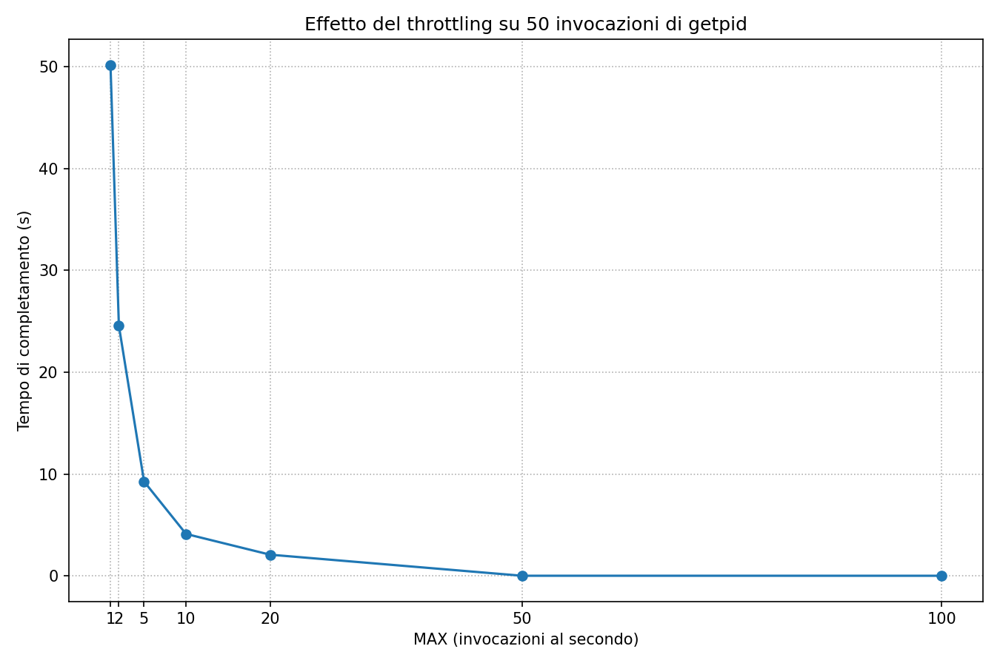
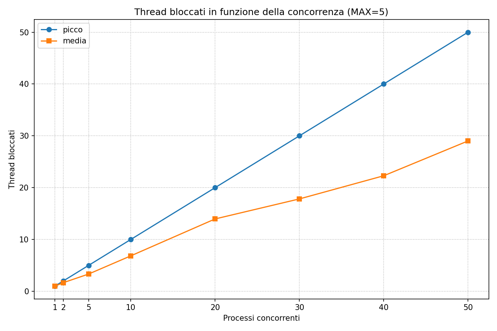

# Syscall Throttling — Linux Kernel Module (LKM)

Progetto del corso Advanced Operating Systems (and System Security) del prof. Francesco Quaglia dell'Università di Roma Tor Vergata per l'anno 2025-26.

Autrice: Ilaria Cialfi.

Ulteriori dettagli implementativi e di test sono disponibili nel documento [RELAZIONE.md](docs/RELAZIONE.md).

## Descrizione

Modulo del kernel Linux (LKM) che monitora e limita la frequenza di invocazione di system call selezionate. Tramite un device a caratteri e `ioctl()` l'amministratore puo' registrare **tre tipi di soggetti**:
- nomi di programma (comm),
- user ID effettivi (EUID),
- numeri di system call (da specifica x86-64).

Una syscall registrata, invocata da un programma registrato **oppure** da un EUID registrato, passa attraverso un monitor. Il monitor applica una soglia **MAX** di invocazioni per finestra di **1 secondo**, **per singolo soggetto registrato**: oltre MAX il thread chiamante viene **bloccato temporaneamente** (la syscall reale non viene eseguita finché il thread non è autorizzato a proseguire). Il monitor si può accendere/spegnere a runtime; la configurazione è leggibile sempre e da qualsiasi utente, ma modificabile solo da `EUID 0` (root). 
Il modulo fornisce inoltre alcune **statistiche**: 
- picco di ritardo con programma/EUID responsabili, 
- numero massimo di thread bloccati,
- numero medio di thread bloccati.

## Struttura del repository

| File                               | Ruolo                                                                                                                                                                                 |
| ---------------------------------- | ------------------------------------------------------------------------------------------------------------------------------------------------------------------------------------- |
| `main.c`                           | Ingresso/uscita del modulo (`init_module`/`cleanup_module`), riceve l'indirizzo della sys_call_table come parametro, avvia la finestra delle statistiche, guida lo spegnimento sicuro|
| `device.c`                         | Device a caratteri + dispatcher `ioctl` (le scritture richiedono EUID 0; le letture sono aperte a tutti)|
| `registry.c`                       | Gestione della configurazione (syscall / EUID / programmi registrati, MAX, monitor on-off), conteggio nella finestra di 1 secondo per soggetto, e calcolo delle statistiche|
| `sctable.c`                        | Aggancio alla sys_call_table: installa un wrapper generico al posto di una syscall registrata e ripristina il puntatore originale; contiene la logica di rimozione sicura del modulo|
| `throttler.h`                      | Header interno (nome del modulo, dichiarazioni di funzione condivise, costanti dei risultati di soggetto)|
| `throttle_ioctl.h`                 | Codici dei comandi ioctl e `struct throttle_config`, condivisi fra modulo e programmi utente|
| `lib/scth.c`, `lib/include/scth.h` | Libreria del corso (`scth`) per l'utilizzo delle funzioni unprotect/protect necessarie per la scrittura delle entry nella sys_call_table|
| `Makefile`                         | Build del modulo, dello strumento di configurazione utente e dei test|
| `user/throttlectl.c`               | Strumento utente di configurazione (registrazione/deregistrazione, set MAX, monitor on/off, `show`, `stats`)|
| `test/test_*.c`                    | Programmi di test (vedi *Test*)|
| `test/run_tests.sh`                | Test che generano due CSV in `test/output/`: effetto del throttling al variare di MAX e della concorrenza|
| `test/graph_generator.py`          | Genera i grafici PNG dai CSV in `test/output/` (vedi *Misure e grafici*)|

L'indirizzo della sys_call_table è ottenuto dal modulo discoverer del prof. Quaglia `the_usctm`, caricato prima di questo modulo; `make mount` legge l'indirizzo da `/sys/module/the_usctm/parameters/sys_call_table_address`.

## Compilazione e caricamento

Sviluppato e testato su Ubuntu 24.04 LTS, kernel `6.8.0-147-generic`.

Requisiti:
- modulo discoverer `the_usctm` del prof. Quaglia (fornisce l’indirizzo della sys_call_table);
	`git clone https://github.com/FrancescoQuaglia/Linux-sys_call_table-discoverer.git`
- header del kernel in esecuzione;
	`sudo apt install linux-headers-$(uname -r)`
- toolchain di compilazione (`gcc`, `make`).
	`sudo apt install build-essential`

```
# 1. carica il discoverer
cd Linux-sys_call_table-discoverer
make clean && make
sudo insmod the_usctm.ko

# 2. compila e carica il modulo, lo strumento userspace e i programmi di test
cd syscall-throttling-SOA_25-26
make clean && make
sudo make mount

# 3. Opzionale: controlla che il modulo sia stato caricato
lsmod | grep throttler
```

Scaricamento con `sudo make unmount`. Dopo ogni aggiornamento di kernel sia `the_usctm` sia `throttler` vanno ricompilati (un modulo gira solo sul kernel per cui è stato compilato).

## Uso

Ogni configurazione avviene tramite il programma utente `throttlectl` (i comandi di configurazione richiedono `sudo`; `show`/`stats` no):

```
sudo ./user/throttlectl on                  # accende il monitor
sudo ./user/throttlectl add-sys  <n>        # registra il numero di syscall n
sudo ./user/throttlectl del-sys  <n>        # deregistra il numero di syscall n
sudo ./user/throttlectl add-uid  <id>       # registra un EUID
sudo ./user/throttlectl del-uid  <id>       # deregistra un EUID
sudo ./user/throttlectl add-prog <name>     # registra un programma (per nome)
sudo ./user/throttlectl del-prog <name>     # deregistra un programma (per nome)
sudo ./user/throttlectl set-max  <n>        # imposta MAX (invocazioni per sec)
sudo ./user/throttlectl off                 # spegne il monitor (nessun limite)
     ./user/throttlectl show                # mosrta la configurazione corrente
     ./user/throttlectl stats               # mostra le statistiche
```

Esempio: limitare `write` da `test_args` a 5/secondo:

```
sudo ./user/throttlectl on
sudo ./user/throttlectl add-sys 1
sudo ./user/throttlectl add-prog test_args
sudo ./user/throttlectl set-max 5
./test/test_args 30        # le 30 write vengono limitate a 5 al secondo
```

## Scelte di design

A seguire le decisioni implementate nello sviluppo del modulo.
* **Aggancio: sostituzione nella sys_call_table**. Un unico **wrapper generico** (`long (*)(const struct pt_regs *)`, valido dal kernel 4.17) serve tutte le syscall agganciate e le distingue tramite `regs->orig_ax`; il puntatore originale è salvato e ripristinato alla deregistrazione/scaricamento.
- **Scelta del program name: `current->comm`** (come nel `reference_monitor.c` del corso), non la risoluzione del percorso assoluto. Limite noto: `TASK_COMM_LEN` = 16, quindi il program name risulta essere il nome troncato a 15 caratteri; `add-prog` registra il nome breve.
- **Le scritture richiedono EUID 0:**  `current->cred->euid.val == 0`(come nel `reference_monitor.c` del corso), il comando di lettura (`GET_CONFIG`) è gestito prima del controllo, quindi la lettura è aperta a tutti.
- **MAX è per singolo soggetto registrato**, non globale: ogni programma/EUID registrato ha il proprio contatore e la propria finestra. Una chiamata che fa match sia per programma sia per EUID è conteggiata su entrambi e bloccata se almeno uno supera MAX.
- **Finestra fissa di 1 secondo**, misurata con `jiffies` + `HZ` (`time_after`). Il valore di default di MAX è **illimitato** (`ULONG_MAX`): finché non si esegue `set-max` nulla viene limitato; `set-max 0` impostato esplicitamente blocca tutte le chiamate registrate.
- **Il blocco** riusa il modello a wait-queue del corso (`queuing-service.c`): oltre MAX il thread dorme il residuo della finestra con `wait_event_interruptible_timeout`, poi ri-conteggia.
- **Gestione segnali:** un segnale ricevuto durante il blocco restituisce `-ERESTARTSYS` e la syscall originale **non** viene eseguita.
- **Statistiche**: il picco di ritardo di una singola invocazione bloccata è misurato con `ktime_get()` attorno al ciclo di blocco (esclude l'esecuzione della syscall reale) e registrato con il programma e l'EUID responsabili; il numero di thread attualmente bloccati (`blocked_threads`) è tracciato sotto il mutex del registro, tenendo il massimo corrente (`peak_blocked_threads`) e la somma dei tempi di blocco, da cui si ricava la media sulla finestra di osservazione (che riparte all’accensione del monitor). Le statistiche si leggono con lo stesso `GET_CONFIG` prima del controllo EUID 0.
- **Rimozione sicura**: è presente un contatore atomico delle chiamate in corso (`active_calls`) più un flag `unloading`. `cleanup_module` alza `unloading`, sveglia i thread bloccati, ripristina la tabella (nessuna nuova chiamata può entrare nel wrapper), poi **drena** le chiamate in corso (`while (atomic_read(&active_calls) > 0) schedule();`) finché il contatore `active_calls` scende a 0, e solo allora deregistra il device.
- **Syscall senza ritorno:** Le syscall che non ritornano (`exit`, `exit_group`, `rt_sigreturn`) sono rifiutate alla registrazione, perché non decrementerebbero mai `active_calls` e terrebbero appeso il drenaggio.
## Limiti noti

- **Troncamento del nome programma**: i nomi più lunghi di 15 caratteri sono confrontati sui primi 15 char, coerentemente con il troncamento di `current->comm`.
- **Latenza di riconfigurazione**: un thread bloccato reagisce allo spegnimento del monitor / deregistrazione / cambio di MAX entro al massimo una finestra di 1 secondo (si sveglia al suo timeout e ricontrolla), non istantaneamente.
- **Statistica della media**: calcolata sulla finestra di osservazione, che riparte a ogni accensione del monitor (`on`); i burst brevi risultano comunque diluiti sulla durata della sessione di monitoring; per un valore rappresentativo si misura subito dopo un ricaricamento/riaccensione del monitor.
- **Rimozione sicura e syscall intrinsecamente bloccanti**: un thread fermo a tempo indefinito dentro la syscall *originale* (es. un demone di sistema in `poll`) tiene `active_calls` sopra lo zero, quindi lo scaricamento attende il suo ritorno. È sicuro (nessun crash), solo non istantaneo.

## Test

Programmi utente per supportare il testing (`/test/`):

- `test_ioctl` — esercita ogni comando ioctl e i relativi percorsi d'errore (doppia registrazione, deregistrazione di una voce assente, comando sconosciuto, syscall fuori intervallo e non-returning); eseguito con `sudo` per i percorsi d'errore, senza `sudo` per verificare i permessi.
- `test_syscall_by_nr <nr> <n>` — esegue un processo con `n` invocazioni della syscall `nr`.
- `test_args <n>` —  lancia `n` chiamate `write` (syscall con argomenti): per verificare che gli argomenti siano inoltrati intatti.
- `test_blockingsys <n>` — esegue `n` chiamate `clock_nanosleep` (syscall bloccante): verifica che una syscall bloccante sia limitata mentre il suo blocco interno continua a funzionare.
- `test_blocked <nr> <nproc> <calls>` — lancia `nproc` processi che chiamano la syscall `nr` in concorrenza sullo stesso soggetto (statistica picco/media thread bloccati, concorrenza).

I programmi di test sono compilati da `make` nella cartella `test/` e si lanciano dalla radice del repo. 
Esempio:

    sudo ./user/throttlectl on
    sudo ./user/throttlectl add-sys 39
    sudo ./user/throttlectl add-prog test_syscall_by_nr
    sudo ./user/throttlectl set-max 5
    ./test/test_syscall_by_nr 39 30      # 30 getpid, limitate a 5/s

## Misure e grafici

Due script in `test/` raccolgono misure del modulo e ne generano i grafici.

- `test/run_tests.sh` — fa variare MAX (tempo di completamento di N invocazioni di `getpid`) e il numero di processi concorrenti   (thread bloccati), scrivendo due CSV in `test/output/`. Da lanciare dalla radice col discoverer caricato:

      sudo bash test/run_tests.sh

- `test/graph_generator.py` — legge i due CSV e produce i grafici PNG in `test/output/` (richiede matplotlib: `sudo apt install python3-matplotlib`):

      python3 test/graph_generator.py



